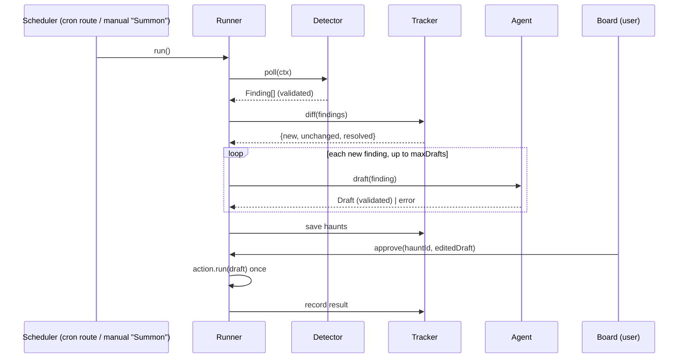

# Design: Crypt Kit

## Overview

A pnpm monorepo. The core loop is framework-free TypeScript. Each app is a thin Next.js shell that supplies a detector, an action, an agent prompt and a theme.

```
crypt-kit/
├─ packages/
│  ├─ core/            # Detector, Runner, Tracker, Agent, Action contracts (no React)
│  ├─ store-sqlite/    # default TrackerStore adapter (libSQL: local file or Turso)
│  ├─ board/           # React board components + theme contract
│  ├─ mcp/             # MCP server over a running app's haunts
│  └─ create-crypt-app/# scaffold CLI
├─ apps/
│  ├─ exorcist/        # GitHub stale issues and PRs
│  └─ poltergeist/     # price-drop watchlist
└─ .kiro/              # specs, steering, hooks
```

## Core loop



## Contracts (packages/core)

```ts
export interface Finding<P> {
  key: string;            // stable across runs
  kind: string;
  severity: 'low' | 'medium' | 'high';
  title: string;
  payload: P;
  observedAt: string;     // ISO
}

export interface Detector<P> {
  id: string;
  payloadSchema: z.ZodType<P>;
  poll(ctx: PollContext): Promise<Finding<P>[]>;   // no model calls
}

export interface Draft {
  summary: string;
  proposal: string;       // user-editable text
  reasoning: string;
  options?: Record<string, boolean>;  // e.g. { close: true }
}

export interface Agent<P> {
  // Returns unknown on purpose: the runner validates it with draftSchema.
  draft(finding: Finding<P>): Promise<unknown>;
}

export interface Action<P> {
  id: string;
  run(finding: Finding<P>, draft: Draft): Promise<ActionResult>;
}

export type HauntStatus =
  | 'new' | 'drafted' | 'draft_failed'
  | 'approving' | 'approved' | 'action_failed' | 'spared' | 'resolved';

// Every Haunt carries `version` (1 on insert, +1 per write).
// Kept to three methods so adapters stay small; the runner owns status logic.
export interface TrackerStore {
  get(key: string): Promise<Haunt | null>;
  // Compare-and-set: writes only if the stored version equals expectedVersion
  // (null = key must not exist). Returns false on conflict.
  put(h: Haunt, expectedVersion: number | null): Promise<boolean>;
  list(filter?: { detectorId?: string; status?: readonly HauntStatus[] }): Promise<Haunt[]>;
}

export interface Runner<P> {
  run(): Promise<RunReport>;
  // edits: { proposal?, options?, expectedVersion? }. With expectedVersion, approve fails
  // with `conflict` if the haunt changed since the user reviewed it (no stale edits).
  approve(key: string, edits?: DraftEdits): Promise<OperationResult<P>>;
  spare(key: string): Promise<OperationResult<P>>;
  redraft(key: string): Promise<OperationResult<P>>;
  settle(key: string, outcome: 'done' | 'not_done'): Promise<OperationResult<P>>;
  list(status?: readonly HauntStatus[]): Promise<Haunt<P>[]>;
}
```

### Status transitions

| From | Event | To |
|---|---|---|
| (none) | seen by a poll | `new` |
| `new` | run: claim (before calling the agent) | `drafting` |
| `drafting` past `claimExpiresAt` | seen by a poll / absent from a poll | `new` with the newest payload / `resolved` |
| `drafting` | agent returns a valid draft / fails | `drafted` / `draft_failed` |
| `drafted`, `action_failed` | approve: claim (before the action runs) | `approving` |
| `approving` | action ok / fails, result saved | `approved` / `action_failed` |
| `approving` | action times out, result can't be saved, or the process died | stays `approving` (needs a check) |
| `approving` past `claimExpiresAt` | settle `done` / `not_done` (user checked the source) | `approved` / `drafted` |
| `new`, `drafting`, `drafted`, `draft_failed`, `action_failed` | spare (a draft in flight is discarded) | `spared` |
| `drafted`, `draft_failed` | redraft | `drafted` / `draft_failed` |
| any open status, `spared` | key absent from a successful poll (an invalid finding still counts as present) | `resolved` |
| `resolved`, `spared` | seen with the same payload hash it had when spared | `spared` (the rejection sticks) |
| `resolved`, `spared` | seen otherwise | `new` (keeps `firstSeenAt`) |
| `drafting` before `claimExpiresAt`, any `approving`, `approved` | any poll | unchanged (a poll never rewrites a live claim or an approval) |

### Runner rules

- `run()` is idempotent per key. Unchanged keys never trigger a draft (R2.2). Concurrent `run()` calls for the same store and detector share one in-flight run, even across runner instances.
- A run only resolves haunts that were neither seen nor written after its own poll started, so a slow poll (from any runner or process) can't resolve items a newer poll found or a draft that landed meanwhile. The next run resolves them if they're really gone.
- Validated payloads must be plain JSON (`findNonJson`), because haunts are persisted as JSON. Detectors convert dates and other rich types to strings or numbers.
- A `spared` haunt is re-drafted only if `hash(payload)` changes (R4.3).
- An `approved` haunt stays closed unless the app sets `reopenApprovedOnChange`. Then a poll that finds its payload changed reopens it as `new`. Exorcist uses this so an issue that goes stale again after a comment comes back; Poltergeist doesn't need it, since a new price is a new key. An `approving` haunt is never reopened.
- A draft answers the payload it was written for. When a poll finds a `drafted`, `draft_failed` or `action_failed` haunt's payload changed, the draft is dropped and the haunt goes back to `new` to be drafted again.
- Like resolving, reopening and dropping drafts only apply to haunts not written after the poll started, so a slow poll can't undo a newer approval, draft or error.
- `maxDraftsPerRun` defaults to 20 (R3.4). Findings over the cap stay `new` and are drafted oldest-first on the next run.
- Every write is compare-and-set on `version`, so concurrent writers in any process can't overwrite each other. A write that loses is skipped and counted in `RunReport.conflicts`, or returned as `conflict` from an operation.
- Approve is claim, act, record. The claim moves the haunt to `approving` with a versioned write before the action runs, so only one process can reach the action (R4.2). If the result can't be saved, the haunt stays `approving` and approve returns `outcome_unknown`. The board then asks the user to check the source and settle it, rather than offering approve again.
- Actions get an `AbortSignal` and a hard timeout (`actionTimeoutMs`, default 60 s) counted from before the claim write. If the claim's acknowledgement uses up the budget, the action never starts (`not_started`) and the haunt is handed back, so an action can't outlive its claim's deadline. A timeout leaves the haunt `approving`, never `action_failed`, because the action may still have landed.
- Claims store their own deadline in `claimExpiresAt`, computed by the claiming runner, so runners with different configs agree on when a claim expires.
- `settle()` is refused until the approval claim's deadline (the claimer's `settleAfterMs`, default 5 min, which must exceed its action timeout). Before then the original attempt, possibly in another process, could still act, so retrying could run the action twice. Action-level idempotency (task 7's marker) closes the remaining gap.
- Drafting is claimed too: a run moves a haunt to `drafting` with a versioned write before calling the agent, so concurrent runs pay for one model call. Polls leave a live draft claim alone and never resolve it. Once it expires (the claimer's `draftClaimTimeoutMs`, default 2 min), the next poll releases it to `new` with the newest observation, or resolves it if the item is gone.
- `spare()` doesn't take the per-key lock, so a draft in flight in the same process can still be spared. The versioned write keeps it safe, and the late draft is dropped.
- An in-process per-key lock, shared by runners on the same store object, avoids wasted agent and action calls inside one process. Versioned writes are what make it correct across processes.
- A failed poll resolves nothing, since it says nothing about what disappeared.
- Approve edits can change the proposal and toggle options the draft already has. They cannot add new options.
- Detector and agent failures are isolated. A failing draft never hides detection results (R3.3).

## Agent

- `@crypt-kit/agent` exports `createAiAgent({ model, instructions, options?, describe?, maxRetries? })`. It calls AI SDK 7's `generateText` with `Output.object` and a Zod schema (`generateObject` is legacy in v7), then the runner re-validates the result with `draftSchema` (R3.2).
- `options` lists the app's yes/no toggles (e.g. `['close']`). The output schema requires exactly those keys, so it stays strict on every provider and the model can't invent new options.
- `modelFromEnv()` reads `CRYPT_MODEL_PROVIDER` (`bedrock` default, or `gateway` for the Vercel AI Gateway) and a required `CRYPT_MODEL_ID`. There's no default model ID, because IDs change often. Credentials stay in each provider's own variables (`AWS_REGION` with `AWS_BEARER_TOKEN_BEDROCK` or AWS keys; `AI_GATEWAY_API_KEY` or Vercel OIDC) (R3.5, R3.6).
- The prompt holds the app's instructions, then fixed untrusted-input rules, then one finding as JSON inside `<finding>` tags with `<` escaped, so source text can't close the tag. `describe(finding)` controls exactly what is sent; the default is title, kind, severity, URL and payload. No secrets and no other findings are sent.
- The agent forwards the runner's abort signal. The runner aborts it a margin (≤ 5 s) before the draft claim expires and stops waiting at the same time, so an overrunning call ends as `draft_failed` (redraftable) instead of being paid for twice after a takeover.
- The draft is never executed. The approval gate is the control (R4.1).

## Persistence

- `@crypt-kit/store-sqlite` is one adapter on `@libsql/client`. The same SQL runs on a local `file:` database in development and on Turso in production, because local SQLite files don't persist on serverless (R2.4, R2.5). Configure with `CRYPT_DB_URL` and `CRYPT_DB_AUTH_TOKEN`; the default is `file:crypt-kit.db`.
- One table per app (default `crypt_haunts`): `key` PK, `detector_id`, `status`, `version`, `first_seen_at` and the full haunt as JSON in `data`, plus an index `<table>__by_detector` on `(detector_id, status, first_seen_at, key)`. On migrate, an old-style `<table>_by_detector` index (from before the rename) is dropped if it belongs to this table or occupies this table's name, but only when its definition matches the old one exactly. Table names are lowercase letters, digits and single underscores (max 48, no `sqlite_` prefix): SQLite compares names case-insensitively, and banning `__` means no table can share a name with another store's index.
- Inserts use `ON CONFLICT (key) DO NOTHING` and updates use `WHERE key = ? AND version = ?`. Each write is one statement, so the version check and the write are atomic.
- `assertTrackerStoreContract` in `@crypt-kit/core/testing` is the conformance suite. The memory store and the libSQL store both pass it, and any new adapter must too.

## Board (packages/board)

- Server components fetch haunts. Only interactive parts are client components: the haunt card actions, the draft editor and the animations.
- The theme contract is `{ creature, palette, copy, motion }` and is passed as a typed prop. Apps don't fork components.
- Motion uses CSS and View Transitions, with a reduced-motion fallback (R5.4).
- Keyboard shortcuts: `A` approve, `R` spare, `E` edit, `J/K` next and previous. Every shortcut also has a visible button (R5.5).
- **Visual spec: mockup B · Graveyard** (`mockups/board/board-mockups.html?view=b`, both themes), chosen Nov 17 over A (triage queue) and C (one card at a time) (R5.6). Build to match it and pixel-compare against it:
  - Header: brand mark, open count, weekly score, run button. Below it, a weekly progress meter and the keyboard hints.
  - The yard: each haunt is an arched tombstone with a floating creature, title, meta, status pill (and price for Poltergeist). The stones sit on a horizon that stays centred, so a short list doesn't leave half the page empty.
  - Opening a stone slides in a right-hand drawer with the shared haunt detail (facts, summary, editable proposal, options, why, approve/spare). The board behind dims.
  - Approve makes the stone rise and dissolve; spare makes it sink. A stuck `approving` haunt shows the check-the-source notice with settle buttons disabled until unlock.
  - Tokens: Exorcist = spectral cyan `#8ef0d8` on `#0b0e14`; Poltergeist = candle amber `#ffb347` on `#120b10`; serif display headings, system sans body.

## Apps

| | Exorcist | Price Poltergeist |
|---|---|---|
| Source | GitHub REST (`issues` incl. PRs), fine-grained token | `PriceSource`: fixture + CheapShark (live, no key); Best Buy (stretch, key-gated) |
| Key | `owner/repo#number` | `source:itemId@price` (e.g. `cheapshark:612@4.99`) |
| Trigger | no activity for N days | price ≤ target |
| Draft | triage comment + close option | buy-or-wait verdict |
| Action | post comment, close if kept | open product link (never purchases) |
| Creature | ghosts | poltergeists |

### Price sources

```ts
export interface PriceQuote {
  itemId: string; title: string; price: number; currency: string;
  normalPrice?: number; historicLow?: number; store?: string; url: string;
}
export interface PriceSource {
  id: 'fixture' | 'cheapshark' | 'bestbuy';
  enabled(): boolean;                       // bestbuy: !!process.env.BESTBUY_API_KEY
  quote(itemIds: string[]): Promise<PriceQuote[]>;
  search(query: string): Promise<PriceQuote[]>; // for adding to the watchlist
}
```

- **CheapShark (primary):** an official public API with no key. Watchlist items are CheapShark game IDs, and `historicLow` comes from the game lookup and is passed to the agent. Responses are cached server-side (default 1 hour) and requests are serialized. Before building, read CheapShark's usage notes (rate limits, caching, User-Agent, deal link format) and copy them into `steering/price-sources.md`.
- **Best Buy (stretch):** the Products API keyed by SKU. It needs a free key: 50,000 calls/day and 5 calls/sec. The key lives only in server env, and the source is hidden in the UI when no key is set.
- **Amazon and eBay are out.** Amazon's Creators API requires an Associates account with qualifying sales. eBay listings are per-seller and expire, so they don't produce stable item keys. Scraping is out.

## MCP server (packages/mcp)

The server exposes these tools: `list_haunts`, `get_haunt`, `redraft_haunt`, and `request_approval`. `request_approval` marks a haunt as awaiting approval on the board but never runs the action itself. The human gate holds even when Kiro is driving (R8.4).

## Kiro usage (R8)

- **Specs:** this spec, plus one small spec per app.
- **Steering:**
  - `steering/detector-contract.md`: the contract plus the "no AI before detection" rule.
  - `steering/ui.md`: the theme contract, reduced motion and accessibility rules.
- **Hooks:**
  - On save of `**/detectors/*.ts`, run that detector's contract tests.
  - On save of `packages/core/**`, run the core tests.
- **MCP:** the server above, used during development to triage demo data.
- **Scaffold:** `pnpm create crypt-app <name>` generates the detector, action, prompt, theme and a fixture test.

## Testing

- Vitest for core. Use the contract helper with recorded fixtures for each detector, mock the agent and assert there are zero model calls inside `poll`.
- Runner tests cover dedup, resolve, the spared/re-draft hash, the draft cap, the double-approve lock, and two simulated processes sharing one store (one action per approval, stuck `approving`, settle).
- Store adapters run `assertTrackerStoreContract`. The libSQL adapter also runs two real connections against one database file.
- Playwright smoke test per app: run, see a haunt, edit, approve, see the banish state.

## Security

- Secrets live in env vars only. The GitHub token is fine-grained and limited to the configured repos.
- Every form and route that triggers an action is protected by Vercel BotID, with the server action as the first gate.
- The public demo runs Exorcist against a sandbox repo the kit owns, and Poltergeist against fixtures. No real user tokens are involved.

## Open questions

1. **Exorcist demo repo:** create a dedicated public sandbox repo under your account or org.
2. **Repo owner:** your personal account or alosolutions.
