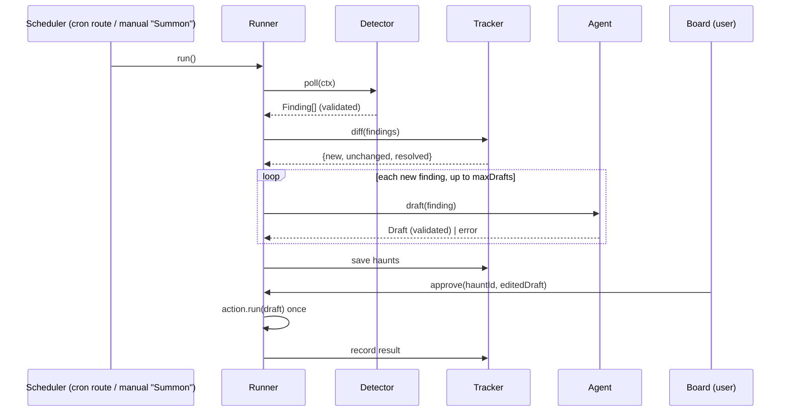

# Design: Crypt Kit

## Overview

A pnpm monorepo. The core loop is framework-free TypeScript. Each app is a thin Next.js shell that supplies a detector, an action, an agent prompt and a theme.

```
crypt-kit/
├─ packages/
│  ├─ core/            # Detector, Runner, Tracker, Agent, Action contracts (no React)
│  ├─ store-sqlite/    # default Tracker adapter (better-sqlite3)
│  ├─ board/           # React board components + theme contract
│  ├─ mcp/             # MCP server over a running app's haunts
│  └─ create-crypt-app/# scaffold CLI
├─ apps/
│  ├─ exorcist/        # GitHub stale issues and PRs
│  └─ poltergeist/     # price-drop watchlist
└─ .kiro/              # specs, steering, hooks
```

## Core loop



## Contracts (packages/core)

```ts
export interface Finding<P> {
  key: string;            // stable across runs
  kind: string;
  severity: 'low' | 'medium' | 'high';
  title: string;
  payload: P;
  observedAt: string;     // ISO
}

export interface Detector<P> {
  id: string;
  payloadSchema: z.ZodType<P>;
  poll(ctx: PollContext): Promise<Finding<P>[]>;   // no model calls
}

export interface Draft {
  summary: string;
  proposal: string;       // user-editable text
  reasoning: string;
  options?: Record<string, boolean>;  // e.g. { close: true }
}

export interface Agent<P> {
  // Returns unknown on purpose: the runner validates it with draftSchema.
  draft(finding: Finding<P>): Promise<unknown>;
}

export interface Action<P> {
  id: string;
  run(finding: Finding<P>, draft: Draft): Promise<ActionResult>;
}

export type HauntStatus =
  | 'new' | 'drafted' | 'draft_failed'
  | 'approved' | 'action_failed' | 'spared' | 'resolved';

// Kept to three methods so adapters stay small; the runner owns status logic.
export interface TrackerStore {
  get(key: string): Promise<Haunt | null>;
  upsert(h: Haunt): Promise<void>;
  list(filter?: { detectorId?: string; status?: readonly HauntStatus[] }): Promise<Haunt[]>;
}

export interface Runner<P> {
  run(): Promise<RunReport>;
  approve(key: string, edits?: DraftEdits): Promise<OperationResult<P>>;
  spare(key: string): Promise<OperationResult<P>>;
  redraft(key: string): Promise<OperationResult<P>>;
  list(status?: readonly HauntStatus[]): Promise<Haunt<P>[]>;
}
```

### Status transitions

| From | Event | To |
|---|---|---|
| (none) | seen by a poll | `new` |
| `new` | agent returns a valid draft / fails | `drafted` / `draft_failed` |
| `drafted`, `action_failed` | approve → action ok / fails | `approved` / `action_failed` |
| `new`, `drafted`, `draft_failed`, `action_failed` | spare | `spared` |
| `drafted`, `draft_failed` | redraft | `drafted` / `draft_failed` |
| any open status, `spared` | key absent from a successful poll (an invalid finding still counts as present) | `resolved` |
| `resolved`, `spared` | seen with the same payload hash it had when spared | `spared` (the rejection sticks) |
| `resolved`, `spared` | seen otherwise | `new` (keeps `firstSeenAt`) |
| `approved` | anything | stays `approved` |

### Runner rules

- `run()` is idempotent per key. Unchanged keys never trigger a draft (R2.2). Concurrent `run()` calls share one in-flight run.
- A `spared` haunt is re-drafted only if `hash(payload)` changes (R4.3).
- `maxDraftsPerRun` defaults to 20 (R3.4). Findings over the cap stay `new` and are drafted oldest-first on the next run.
- Every write takes a per-key lock and re-reads the haunt first. Locks are shared by every runner on the same store object, so per-request runners are safe too. A double click cannot run an action twice, and a run skips keys that are mid-approval (R4.2). The lock is in-process; cross-process safety is the store adapter's job.
- A failed poll resolves nothing, since it says nothing about what disappeared.
- Approve edits can change the proposal and toggle options the draft already has. They cannot add new options.
- Detector and agent failures are isolated. A failing draft never hides detection results (R3.3).

## Agent

- Built on the Vercel AI SDK `generateObject` with a Zod draft schema. This validates structured output (R3.2).
- Provider is chosen by `CRYPT_MODEL_PROVIDER` (`bedrock` default, `anthropic`, `openai`) and `CRYPT_MODEL_ID` (R3.5).
- The prompt receives only the single finding payload plus the app's system prompt. It gets no secrets and no other findings.
- Untrusted text in findings (issue bodies, product pages) is wrapped as data in the prompt, and the agent's draft is never executed. The approval gate is the control (R4.1).

## Persistence

- `store-sqlite` holds one `haunts` table: key PK, status, finding JSON, draft JSON, payload hash, result JSON, timestamps.
- On Vercel, the demo uses Turso (libSQL) through the same adapter interface, because local SQLite files don't persist on serverless (R2.5).

## Board (packages/board)

- Server components fetch haunts. Only interactive parts are client components: the haunt card actions, the draft editor and the animations.
- The theme contract is `{ creature, palette, copy, motion }` and is passed as a typed prop. Apps don't fork components.
- Motion uses CSS and View Transitions, with a reduced-motion fallback (R5.4).
- Keyboard shortcuts: `A` approve, `R` spare, `E` edit, `J/K` next and previous. Every shortcut also has a visible button (R5.5).
- The visual direction is not decided here. Each app gets 2-3 mockups first, and the chosen mockup becomes its visual spec (R5.6).

## Apps

| | Exorcist | Price Poltergeist |
|---|---|---|
| Source | GitHub REST (`issues` incl. PRs), fine-grained token | `PriceSource`: fixture + CheapShark (live, no key); Best Buy (stretch, key-gated) |
| Key | `owner/repo#number` | `source:itemId@price` (e.g. `cheapshark:612@4.99`) |
| Trigger | no activity for N days | price ≤ target |
| Draft | triage comment + close option | buy-or-wait verdict |
| Action | post comment, close if kept | open product link (never purchases) |
| Creature | ghosts | poltergeists |

### Price sources

```ts
export interface PriceQuote {
  itemId: string; title: string; price: number; currency: string;
  normalPrice?: number; historicLow?: number; store?: string; url: string;
}
export interface PriceSource {
  id: 'fixture' | 'cheapshark' | 'bestbuy';
  enabled(): boolean;                       // bestbuy: !!process.env.BESTBUY_API_KEY
  quote(itemIds: string[]): Promise<PriceQuote[]>;
  search(query: string): Promise<PriceQuote[]>; // for adding to the watchlist
}
```

- **CheapShark (primary):** an official public API with no key. Watchlist items are CheapShark game IDs, and `historicLow` comes from the game lookup and is passed to the agent. Responses are cached server-side (default 1 hour) and requests are serialized. Before building, read CheapShark's usage notes (rate limits, caching, User-Agent, deal link format) and copy them into `steering/price-sources.md`.
- **Best Buy (stretch):** the Products API keyed by SKU. It needs a free key: 50,000 calls/day and 5 calls/sec. The key lives only in server env, and the source is hidden in the UI when no key is set.
- **Amazon and eBay are out.** Amazon's Creators API requires an Associates account with qualifying sales. eBay listings are per-seller and expire, so they don't produce stable item keys. Scraping is out.

## MCP server (packages/mcp)

The server exposes these tools: `list_haunts`, `get_haunt`, `redraft_haunt`, and `request_approval`. `request_approval` marks a haunt as awaiting approval on the board but never runs the action itself. The human gate holds even when Kiro is driving (R8.4).

## Kiro usage (R8)

- **Specs:** this spec, plus one small spec per app.
- **Steering:**
  - `steering/detector-contract.md`: the contract plus the "no AI before detection" rule.
  - `steering/ui.md`: the theme contract, reduced motion and accessibility rules.
- **Hooks:**
  - On save of `**/detectors/*.ts`, run that detector's contract tests.
  - On save of `packages/core/**`, run the core tests.
- **MCP:** the server above, used during development to triage demo data.
- **Scaffold:** `pnpm create crypt-app <name>` generates the detector, action, prompt, theme and a fixture test.

## Testing

- Vitest for core. Use the contract helper with recorded fixtures for each detector, mock the agent and assert there are zero model calls inside `poll`.
- Runner tests cover dedup, resolve, the spared/re-draft hash, the draft cap and the double-approve lock.
- Playwright smoke test per app: run, see a haunt, edit, approve, see the banish state.

## Security

- Secrets live in env vars only. The GitHub token is fine-grained and limited to the configured repos.
- Every form and route that triggers an action is protected by Vercel BotID, with the server action as the first gate.
- The public demo runs Exorcist against a sandbox repo the kit owns, and Poltergeist against fixtures. No real user tokens are involved.

## Open questions

1. **Exorcist demo repo:** create a dedicated public sandbox repo under your account or org.
2. **Repo owner:** your personal account or alosolutions.
